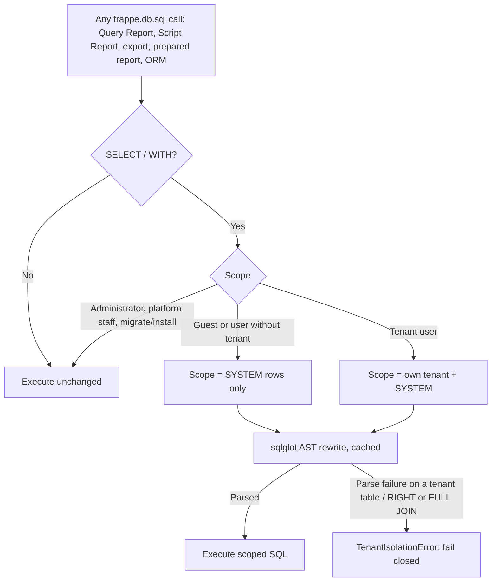

# Multi-Tenant Report Isolation Architecture

> **Context:** Solution design for [GitHub Issue #1: Inject tenant_id filtering condition into every report](https://github.com/vyogotech/saas_platform/issues/1) on `vyogotech/saas_platform`.

---

## 1. Problem Overview

In `saas_platform`, multi-tenancy is designed around a **shared-database, shared-schema** architecture where all tenant records are co-located in the same database tables and partitioned by a `tenant_id` column.

While document creation ([doc_events: before_insert](file:///Users/varkrish/personal/1frappe_ecosystem/saas_platform/saas_platform/hooks.py#L148-L152)) and list views ([permission_query_conditions](file:///Users/varkrish/personal/1frappe_ecosystem/saas_platform/saas_platform/hooks.py#L158-L160)) enforce tenant isolation for ORM operations, **reports remain a major security vulnerability**:

1. **Query Reports (`report_type = "Query Report"`):** Run raw SQL statements directly via [Report.execute_query_report](file:///Users/varkrish/personal/1frappe_ecosystem/frappe/frappe/core/doctype/report/report.py#L180-L192) calling `frappe.db.sql(self.query, filters)`. Standard Frappe does not inject `permission_query_conditions` into raw SQL queries.
2. **Script Reports (`report_type = "Script Report"`):** Standard ERPNext reports (General Ledger, Accounts Receivable/Payable, Trial Balance, Stock Balance, Profit & Loss) and custom reports execute Python `execute(filters)` methods that run handwritten complex raw SQL across multiple tables (`tabGL Entry`, `tabSales Invoice`, `tabItem`, `tabCustomer`, etc.). These reports have no awareness of the custom `tenant_id` column.
3. **The Aggregation Flaw:** Post-filtering rows in Python memory (e.g., via [get_filtered_data](file:///Users/varkrish/personal/1frappe_ecosystem/frappe/frappe/desk/query_report.py#L901-L945)) cannot fix aggregated queries:
   ```sql
   SELECT account, SUM(debit), SUM(credit)
   FROM `tabGL Entry`
   GROUP BY account
   ```
   If executed across all rows, the aggregated values returned by the database are already contaminated with cross-tenant data. Post-filtering cannot untangle these sums. Furthermore, SQL `LIMIT` and `OFFSET` pagination will return inaccurate or empty pages.

---

## 2. Solution Evaluation Matrix

| Strategy | Mechanism | Feasibility in Frappe / MariaDB | Assessment |
| :--- | :--- | :--- | :--- |
| **1. Database-Native Row-Level Security (RLS)** | Use MariaDB / PostgreSQL RLS policies with session variables (`SET @tenant_id = '...'`). | ⚠️ **Low on MariaDB** (Native in PostgreSQL only) | PostgreSQL supports `CREATE POLICY ... USING (tenant_id = ...)`. However, MariaDB (Frappe's default database engine) lacks native table-level RLS policies without converting base tables to views, which breaks `bench migrate` and DDL schema syncing. |
| **2. In-Memory Post-Execution Filtering** | Filter result rows in Python after query completion. | ❌ **Broken** | Cannot correct aggregated queries (`GROUP BY`, `SUM`), pagination offsets (`LIMIT`), or queries omitting `tenant_id` from the `SELECT` column list. Severe memory leak risk. |
| **3. AST-Based SQL Query Rewriting at Driver Layer** | Intercept `Database._transform_query` using an AST parser (`sqlglot`) to dynamically inject `tenant_id` predicates into `WHERE` / `ON` clauses. |  **High** | **Recommended core solution.** Fully transparent; protects raw SQL, joins, subqueries, and CTEs without touching upstream ERPNext report code. |
| **4. Company-Level User Permissions** | Restrict each tenant's user to their auto-provisioned `Company` using Frappe's native `User Permission`. |  **High** | **Recommended supplementary layer.** Restricts standard ERPNext financial reports that natively filter by `company`. Insufficient by itself for DocTypes without a `company` field (e.g. `Customer`, `Item`). |

---

## 3. Architecture: Defense-in-Depth



### Layer 1: AST SQL rewriter (`utils/sql_rewriter.py`)
`install_db_patch()` wraps `Database._transform_query`. It runs at app import and again in `before_request` / `before_job` (idempotent), so every web and background worker is covered.

- **Tenant scope** comes from `utils/tenant.get_tenant_id()`. The `on_session_creation` hook is the only writer of `session.data["tenant_id"]` and saves the session immediately. Requests without it (background jobs, older sessions) fall back to `User.tenant_id`, memoised per user on `frappe.local`.
- **Scoped tables** are those that actually have the raw `tenant_id` column (read from `information_schema`, cached in Redis under a versioned key, cleared in `after_migrate`), minus `SYSTEM_TABLES`. Tables without the column, such as `tabSeries`, are never touched.
- **Predicate** `` (`alias`.tenant_id = '<tenant>' OR `alias`.tenant_id = 'SYSTEM') ``, built as sqlglot AST nodes (no string interpolation, so no SQL injection). `FROM` and inner-join tables get it in `WHERE`; `LEFT JOIN` tables get it in `ON`. No `IS NULL` branch: it would match the NULL-extended rows of outer joins.
- **Refused:** `RIGHT` / `FULL JOIN` on tenant tables (a filter in `ON` does not restrict the preserved side), and any statement on a tenant table that sqlglot cannot parse. Both raise `TenantIsolationError` and log the query.
- **Placeholders** (`%s`, `%(name)s`) are masked before parsing and restored afterwards, so the cache key is the query template and hit rates stay high.

### Layer 2: Company User Permission
Each tenant user gets a `User Permission` on their tenant's `Company`: the admin at provisioning, and later users through the `User` `after_insert` hook. ERPNext reports apply it as a match condition, and `validate_filters_permissions` checks it for server-declared Link filters.

### Layer 3: Document access by name
The `has_permission` hook (`permissions.has_permission`) denies a loaded document whose `tenant_id` belongs to another tenant (`frappe.client`, form loads, `get_doc`).

### Data tagging
`tenant_id` is a raw `ALTER TABLE` column, so Frappe's ORM never writes it. `persist_tenant_id` (`after_insert`, `on_update`, `on_update_after_submit`) writes it to the row and its child rows with `frappe.db.set_value`. During provisioning, `acting_tenant()` tags everything created with the tenant's Company (chart of accounts, cost centers, warehouses).

### Subscriptions: two levels
`tabSubscription` holds both levels, so it is tenant-filtered like any other table:

| Level | What | `tenant_id` | Visible to |
| :--- | :--- | :--- | :--- |
| 1. Platform lease | Our Customer, Subscription and invoices per tenant; everything under the platform Company | `PLATFORM` | Administrator and platform staff only |
| 2. Tenant billing | Subscriptions, plans and invoices a tenant creates for its own customers | the tenant's id | That tenant |

- `PLATFORM` is never matched by the tenant scope (`own OR 'SYSTEM'`). `SYSTEM` stays for reference data shared by everyone.
- Documents created by Administrator or the scheduler (subscription invoices, for example) inherit the tenant of their `company`. The platform Company is tagged `PLATFORM`, so level-1 invoices stay hidden and a tenant's scheduled level-2 invoices stay theirs.
- The platform Company is `saas_platform_company` in site config, or the global default company.
- `patches/tag_platform_records` tags existing level-1 records on upgrade.

### Tenant roles (`utils/roles.py`)
System Manager cannot be scoped to a tenant: what it adds on top of data access acts site-wide. Cloning its permissions would need Custom DocPerms on every DocType, which freezes them against upstream permission changes. Instead:

- **Tenant Admin Role Profile**: every desk role except those that can create, write or delete a site-wide DocType (`PLATFORM_DOCTYPES`: schema, code, global config and triggers, identity, platform). Derived from DocPerm / Custom DocPerm and rebuilt in `after_migrate`, so roles from new apps are picked up without a hand-kept list. Tenant admins are provisioned with this profile.
- **Tenant User Manager** role (in the profile): read/write/create on User, including permlevel 1 (`roles`, `role_profiles`). Scoped by a tenant-only User list filter, the `has_permission` hook (also denying platform `SYSTEM` users such as Administrator), and `validate_tenant_user`, which allows only own-tenant users and only roles from the Tenant Admin profile.

---

## 4. Known Limits

- Only `SELECT` / `WITH` statements are scoped. Raw `UPDATE`, `DELETE` and `INSERT ... SELECT` are not.
- Tenant admins do not get `System Manager`: Query Reports, Server Scripts, System Console and Custom Fields bypass isolation. They get the Tenant Admin profile instead.
- `sqlglot>=30.12,<31` (Frappe v16's own range). The rewriter needs the `from_` arg key, introduced in sqlglot 28.

---

## 5. Verification & Testing

| Suite | Where | Covers |
| :--- | :--- | :--- |
| `utils/test_sql_rewriter.py` | `bench run-tests --module saas_platform.utils.test_sql_rewriter` | Joins, subqueries, CTEs, unions, aggregates, placeholders, injection escaping, RIGHT JOIN refusal, fail-closed parsing, tables without the column, live SQLite isolation |
| End-to-end on an SNE site (49 checks) | Tenants provisioned through `Tenant` | Data tagging (parent and child rows), Query Report, raw aggregates, `get_list`, General Ledger with real GL entries, document access by name, Guest scope, HTTP login across requests, both subscription levels, scheduler inheritance, Tenant Admin profile and Tenant User Manager limits |
| Standard report sweep | 20 ERPNext reports run as a tenant user | 416 of 420 queries rewritten, 0 parse failures, 0 tenant tables left unscoped; p50 overhead 0.007 ms, p95 1.2 ms |

---

## 6. PostgreSQL Support & Dialect Handling

Frappe supports both **MariaDB** and **PostgreSQL** as database backends (`frappe.db.db_type`). PostgreSQL offers unique capabilities and syntax requirements for multi-tenancy.

### A. Automatic Multi-Dialect Transpilation in AST Rewriter
In Frappe's codebase, many queries use MySQL-style backticks (`` `tabCustomer` ``) even when running on PostgreSQL. Our AST rewriter in `saas_platform/utils/sql_rewriter.py` automatically detects the active dialect (`get_db_dialect()`):
- **MariaDB / MySQL:** Emits backticked identifiers (`` `tabCustomer`.tenant_id ``).
- **PostgreSQL:** Automatically transpiles backticks into standard PostgreSQL double-quoted identifiers (`"tabCustomer".tenant_id`), ensuring 100% dialect correctness.

### B. Native PostgreSQL Row-Level Security (RLS) Alternative
While MariaDB lacks native table-level RLS policies, **PostgreSQL natively supports Row-Level Security at the database kernel level**. For deployments exclusively on PostgreSQL, teams can enable native RLS:

1. **Enable RLS on Multi-Tenant Tables:**
   ```sql
   ALTER TABLE "tabSales Invoice" ENABLE ROW LEVEL SECURITY;
   ALTER TABLE "tabSales Invoice" FORCE ROW LEVEL SECURITY;
   ```

2. **Define Restrictive Security Policy:**
   ```sql
   CREATE POLICY tenant_isolation_policy ON "tabSales Invoice"
   AS RESTRICTIVE
   FOR ALL
   TO PUBLIC
   USING (
       tenant_id = NULLIF(current_setting('app.current_tenant', true), '')
       OR tenant_id = 'SYSTEM'
       OR current_setting('app.is_admin', true) = '1'
   );
   ```

3. **Inject Session Context in Frappe Request Hook:**
   ```python
   def before_request():
       if frappe.session.user == "Administrator":
           frappe.db.sql("SET LOCAL app.is_admin = '1'")
       else:
           tenant_id = get_tenant_id()
           if tenant_id:
               frappe.db.sql("SET LOCAL app.current_tenant = %s", (tenant_id,))
   ```

*Comparison:* The AST Query Rewriter provides cross-database compatibility (working identically on MariaDB and Postgres with zero database configuration), while Native PostgreSQL RLS provides kernel-level enforcement for Postgres-only deployments.

---

## 7. Recommended Response to GitHub Issue #1

```markdown
Hi @szufisher,

Thank you for raising this critical point. You have identified the primary hurdle of shared-database multi-tenancy in Frappe: while `permission_query_conditions` cleanly secures ORM lookups (`frappe.get_list`), Query Reports and Script Reports execute raw SQL through `frappe.db.sql`, bypassing permission hooks.

Post-filtering results in Python memory is insufficient because it breaks aggregated queries (`SUM`, `AVG`, `GROUP BY`) and pagination (`LIMIT`/`OFFSET`).

We are adopting a layered solution:

1. **AST-based SQL rewriting at the driver layer:**
   We wrap `Database._transform_query` and use `sqlglot` to add a tenant predicate to every table that carries `tenant_id`, including subqueries, joins and CTEs:
   `(alias.tenant_id = '<tenant_id>' OR alias.tenant_id = 'SYSTEM')`
   - `LEFT JOIN` tables get the predicate in `ON`; `FROM` and inner-join tables get it in `WHERE`.
   - It fails closed: a query on a tenant table that cannot be parsed, or a `RIGHT`/`FULL JOIN`, is refused rather than run unfiltered.
   - Rewrites are cached by query template (p50 overhead of a few microseconds).

2. **Tenant Company binding:**
   Each tenant user gets a `User Permission` on their tenant's `Company`, which ERPNext reports apply to their company filters.

3. **Document-level check:** a `has_permission` hook denies access by name to other tenants' documents.

Full architectural documentation and code blueprint are available in `docs/report_tenant_isolation.md`.
```
