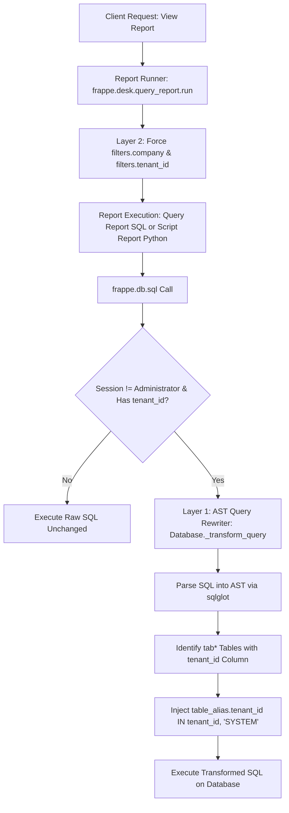

# Multi-Tenant Report Isolation Architecture

> **Context:** Solution design for [GitHub Issue #1: Inject tenant_id filtering condition into every report](https://github.com/vyogotech/saas_platform/issues/1) on `vyogotech/saas_platform`.

---

## 1. Problem Overview

In `saas_platform`, multi-tenancy is designed around a **shared-database, shared-schema** architecture where all tenant records are co-located in the same database tables and partitioned by a `tenant_id` column.

While document creation ([doc_events: before_insert](file:///Users/varkrish/personal/1frappe_ecosystem/saas_platform/saas_platform/hooks.py#L148-L152)) and list views ([permission_query_conditions](file:///Users/varkrish/personal/1frappe_ecosystem/saas_platform/saas_platform/hooks.py#L158-L160)) enforce tenant isolation for ORM operations, **reports remain a major security vulnerability**:

1. **Query Reports (`report_type = "Query Report"`):** Run raw SQL statements directly via [Report.execute_query_report](file:///Users/varkrish/personal/1frappe_ecosystem/frappe/frappe/core/doctype/report/report.py#L180-L192) calling `frappe.db.sql(self.query, filters)`. Standard Frappe does not inject `permission_query_conditions` into raw SQL queries.
2. **Script Reports (`report_type = "Script Report"`):** Standard ERPNext reports (General Ledger, Accounts Receivable/Payable, Trial Balance, Stock Balance, Profit & Loss) and custom reports execute Python `execute(filters)` methods that run handwritten complex raw SQL across multiple tables (`tabGL Entry`, `tabSales Invoice`, `tabItem`, `tabCustomer`, etc.). These reports have no awareness of the custom `tenant_id` column.
3. **The Aggregation Flaw:** Post-filtering rows in Python memory (e.g., via [get_filtered_data](file:///Users/varkrish/personal/1frappe_ecosystem/frappe/frappe/desk/query_report.py#L901-L945)) cannot fix aggregated queries:
   ```sql
   SELECT account, SUM(debit), SUM(credit)
   FROM `tabGL Entry`
   GROUP BY account
   ```
   If executed across all rows, the aggregated values returned by the database are already contaminated with cross-tenant data. Post-filtering cannot untangle these sums. Furthermore, SQL `LIMIT` and `OFFSET` pagination will return inaccurate or empty pages.

---

## 2. Solution Evaluation Matrix

| Strategy | Mechanism | Feasibility in Frappe / MariaDB | Assessment |
| :--- | :--- | :--- | :--- |
| **1. Database-Native Row-Level Security (RLS)** | Use MariaDB / PostgreSQL RLS policies with session variables (`SET @tenant_id = '...'`). | ⚠️ **Low on MariaDB** (Native in PostgreSQL only) | PostgreSQL supports `CREATE POLICY ... USING (tenant_id = ...)`. However, MariaDB (Frappe's default database engine) lacks native table-level RLS policies without converting base tables to views, which breaks `bench migrate` and DDL schema syncing. |
| **2. In-Memory Post-Execution Filtering** | Filter result rows in Python after query completion. | ❌ **Broken** | Cannot correct aggregated queries (`GROUP BY`, `SUM`), pagination offsets (`LIMIT`), or queries omitting `tenant_id` from the `SELECT` column list. Severe memory leak risk. |
| **3. AST-Based SQL Query Rewriting at Driver Layer** | Intercept `Database._transform_query` using an AST parser (`sqlglot`) to dynamically inject `tenant_id` predicates into `WHERE` / `ON` clauses. |  **High** | **Recommended core solution.** Fully transparent; protects raw SQL, joins, subqueries, and CTEs without touching upstream ERPNext report code. |
| **4. Company-Level User Permissions** | Restrict each tenant's user to their auto-provisioned `Company` using Frappe's native `User Permission`. |  **High** | **Recommended supplementary layer.** Restricts standard ERPNext financial reports that natively filter by `company`. Insufficient by itself for DocTypes without a `company` field (e.g. `Customer`, `Item`). |

---

## 3. Recommended Architecture: Defense-in-Depth

The solution employs a multi-tiered defense:



### Layer 1: AST SQL Query Rewriter (Database Driver Hook)
Intercept every raw SQL query executed via `frappe.db.sql` by hooking [Database._transform_query](file:///Users/varkrish/personal/1frappe_ecosystem/frappe/frappe/database/database.py#L188-L189). 

Using `sqlglot` (a pure-Python, zero-dependency SQL parser), the query AST is inspected:
- Identify every table expression (`tab<DocType>`).
- If the table belongs to tenant-isolated DocTypes (not in `SYSTEM_TABLES`):
  - For `FROM` and `INNER JOIN` tables: Append `(table.tenant_id = '{tenant_id}' OR table.tenant_id = 'SYSTEM' OR table.tenant_id IS NULL)` to the `WHERE` clause.
  - For `LEFT JOIN` / `RIGHT JOIN`: Append the condition to the `JOIN ... ON` clause to preserve outer join NULL semantics.
- With LRU caching on normalized query templates, AST rewriting overhead is negligible (< 0.1ms).

### Layer 2: ERPNext Company Locking via User Permission
When a [Tenant](file:///Users/varkrish/personal/1frappe_ecosystem/saas_platform/saas_platform/saas_platform/doctype/tenant/tenant.py#L10) is created, [create_company](file:///Users/varkrish/personal/1frappe_ecosystem/saas_platform/saas_platform/saas_platform/doctype/tenant/tenant.py#L105-L138) provisions a dedicated company for that tenant.
- Create a `User Permission` for the tenant admin linking them to their specific `Company`.
- This ensures that standard ERPNext reports (General Ledger, Trial Balance, Stock Balance, Profit & Loss) default to and lock their Company filter to the tenant's company in the Desk UI.

### Layer 3: Report Interceptor & Query Report Parameterization
- Hook `frappe.desk.query_report.run` to guarantee `filters["tenant_id"] = frappe.session.get("tenant_id")` and `filters["company"] = user_company`.
- Custom Query Reports can optionally use `%(tenant_id)s` explicitly, but Layer 1 ensures safety even if omitted.

---

## 4. Implementation Blueprint

### 1. Add `sqlglot` Dependency

Update [pyproject.toml](file:///Users/varkrish/personal/1frappe_ecosystem/saas_platform/pyproject.toml):

```toml
dependencies = [
    "sqlglot>=20.0.0",
]
```

---

### 2. Create the SQL Rewriter Module

File: `saas_platform/saas_platform/utils/sql_rewriter.py`

```python
"""
SQL AST Rewriter for Multi-Tenant Data Isolation
Dynamically injects tenant_id predicates into SQL queries executed by frappe.db.sql
"""

import functools
import sqlglot
from sqlglot import exp
import frappe

# Tables exempt from tenant filtering
SYSTEM_TABLES = {
    "tabUser", "tabRole", "tabDocType", "tabDocField", "tabDocPerm",
    "tabModule Def", "tabTenant", "tabPlan", "tabSubscription Plan",
    "tabSubscription", "tabSubscription Plan Detail", "tabSessions",
    "tabSystem Settings", "tabWebsite Settings", "tabError Log",
    "tabActivity Log", "tabVersion", "tabCustom Field", "tabProperty Setter",
    "tabSingles", "tabInstalled Applications", "tabPatch Log"
}


@functools.lru_cache(maxsize=2048)
def _rewrite_query_cached(sql: str, tenant_id: str) -> str:
    """
    Parse SQL AST using sqlglot and inject tenant_id condition.
    Cached by query string and tenant_id for high performance.
    """
    parsed = sqlglot.parse_one(sql, read="mysql")

    # Traverse all SELECT expressions (including subqueries, CTEs, and unions)
    for select in parsed.find_all(exp.Select):
        from_table = select.args.get("from")
        tables_to_filter = []

        if from_table and isinstance(from_table.this, exp.Table):
            tables_to_filter.append((from_table.this, False))

        for join in select.args.get("joins", []):
            if isinstance(join.this, exp.Table):
                # Detect outer joins to preserve outer null semantics
                is_outer = (join.side or "").upper() in ("LEFT", "RIGHT", "FULL")
                tables_to_filter.append((join, is_outer))

        for item, is_outer in tables_to_filter:
            tbl = item.this if is_outer else item
            tbl_name = tbl.name
            alias = tbl.alias or tbl_name

            # Skip system tables or non-frappe tables
            if not tbl_name.startswith("tab") or tbl_name in SYSTEM_TABLES:
                continue

            tenant_condition = sqlglot.parse_one(
                f"({alias}.tenant_id = '{tenant_id}' OR {alias}.tenant_id = 'SYSTEM' OR {alias}.tenant_id IS NULL)"
            )

            if is_outer:
                # Append condition to JOIN ... ON
                existing_on = item.args.get("on")
                item.set("on", exp.and_(existing_on, tenant_condition) if existing_on else tenant_condition)
            else:
                # Append condition to WHERE
                select.where(tenant_condition, copy=False)

    return parsed.sql(dialect="mysql")


def rewrite_sql_for_tenant(query: str) -> str:
    """
    Inspect execution context and rewrite query if running under a tenant session.
    """
    # 1. Bypass check: Administrator, schema migrations, installation, or explicit flags
    if (
        frappe.flags.in_migrate
        or frappe.flags.in_install
        or frappe.flags.ignore_tenant_filter
        or frappe.session.user == "Administrator"
    ):
        return query

    # 2. Check session tenant
    tenant_id = frappe.session.get("tenant_id")
    if not tenant_id or tenant_id == "SYSTEM":
        return query

    # 3. Only rewrite SELECT and CTE queries (INSERT/UPDATE handled via doc_events)
    stripped = query.strip().lstrip("(").lower()
    if not (stripped.startswith("select") or stripped.startswith("with")):
        return query

    try:
        return _rewrite_query_cached(query, tenant_id)
    except Exception as e:
        frappe.log_error(
            f"Failed to rewrite query for tenant {tenant_id}: {str(e)}\nOriginal: {query[:300]}",
            "Tenant SQL Rewriter Error"
        )
        return query
```

---

### 3. Register the Database Driver Patch

File: `saas_platform/saas_platform/__init__.py`

```python
import frappe
from frappe.database.database import Database
from saas_platform.utils.sql_rewriter import rewrite_sql_for_tenant

# Monkey-patch Database._transform_query
_orig_transform_query = Database._transform_query

def _tenant_aware_transform_query(self, query, values):
    query, values = _orig_transform_query(self, query, values)
    if isinstance(query, str):
        query = rewrite_sql_for_tenant(query)
    return query, values

Database._transform_query = _tenant_aware_transform_query
```

---

### 4. Create Company User Permission on Tenant Provisioning

In [saas_platform/saas_platform/doctype/tenant/tenant.py](file:///Users/varkrish/personal/1frappe_ecosystem/saas_platform/saas_platform/saas_platform/doctype/tenant/tenant.py), update `setup_admin_user` to create a `User Permission` for the tenant's `Company`:

```python
    def setup_admin_user(self):
        """Create or update admin user for this tenant and bind company permission"""
        try:
            # ... existing user creation logic ...

            # Enforce company user permission
            company_name = self.tenant_name
            if not frappe.db.exists("User Permission", {
                "user": self.admin_email,
                "allow": "Company",
                "for_value": company_name
            }):
                user_perm = frappe.get_doc({
                    "doctype": "User Permission",
                    "user": self.admin_email,
                    "allow": "Company",
                    "for_value": company_name,
                    "is_default": 1
                })
                user_perm.insert(ignore_permissions=True)
                frappe.db.commit()
                frappe.log(f"Linked User Permission Company={company_name} to {self.admin_email}")

        except Exception as e:
            frappe.log_error(f"Failed to setup user permissions for tenant {self.tenant_id}: {str(e)}")
```

---

### 5. Report Runner Interceptor Hook

File: `saas_platform/saas_platform/utils/report_interceptor.py`

```python
import frappe
from frappe.desk.query_report import run as original_run

@frappe.whitelist()
@frappe.read_only()
def tenant_aware_report_run(
    report_name: str,
    filters: str | dict | None = None,
    user: str | None = None,
    ignore_prepared_report: bool = False,
    custom_columns: str | list | None = None,
    is_tree: bool = False,
    parent_field: str | None = None,
    are_default_filters: bool = True,
    js_filters: str | list | None = None,
):
    if isinstance(filters, str):
        filters = frappe.parse_json(filters) or {}
    elif filters is None:
        filters = {}

    user = user or frappe.session.user
    if user != "Administrator":
        tenant_id = frappe.session.get("tenant_id")
        if tenant_id:
            filters["tenant_id"] = tenant_id

            # If user has a tenant company, force company filter
            user_company = frappe.db.get_value("Company", {"tenant_id": tenant_id}, "name")
            if user_company:
                filters["company"] = user_company

    return original_run(
        report_name=report_name,
        filters=filters,
        user=user,
        ignore_prepared_report=ignore_prepared_report,
        custom_columns=custom_columns,
        is_tree=is_tree,
        parent_field=parent_field,
        are_default_filters=are_default_filters,
        js_filters=js_filters,
    )
```

In [saas_platform/saas_platform/hooks.py](file:///Users/varkrish/personal/1frappe_ecosystem/saas_platform/saas_platform/hooks.py#L189-L194):

```python
override_whitelisted_methods = {
    "frappe.desk.query_report.run": "saas_platform.utils.report_interceptor.tenant_aware_report_run"
}
```

---

## 5. Verification & Testing

| Test Case | Scenario | Expected Behavior |
| :--- | :--- | :--- |
| **Simple Query Report** | `SELECT name, customer_name FROM tabCustomer` executed by Tenant A. | Rewritten to `SELECT ... FROM tabCustomer WHERE (tabCustomer.tenant_id = 'tenant-a' OR ...)`. Tenant B's customers are not returned. |
| **Multi-Table Join Report** | `SELECT si.name, sii.item_code FROM tabSales Invoice si JOIN tabSales Invoice Item sii ON ...` | Both `si` and `sii` receive tenant conditions in `WHERE` / `ON`. |
| **Aggregated Script Report** | General Ledger or Trial Balance (`SUM(debit)` grouped by `account`). | Underlying `tabGL Entry` query filtered at SQL level; aggregates accurately represent only Tenant A's figures. |
| **Administrator Bypass** | Administrator runs any Query or Script Report. | Query executed without modifications; sees all records across all tenants. |
| **Schema Migration** | `bench migrate` runs patches. | `frappe.flags.in_migrate` is `True`; AST rewriter bypassed completely. |

---

## 6. PostgreSQL Support & Dialect Handling

Frappe supports both **MariaDB** and **PostgreSQL** as database backends (`frappe.db.db_type`). PostgreSQL offers unique capabilities and syntax requirements for multi-tenancy.

### A. Automatic Multi-Dialect Transpilation in AST Rewriter
In Frappe's codebase, many queries use MySQL-style backticks (`` `tabCustomer` ``) even when running on PostgreSQL. Our AST rewriter in `saas_platform/utils/sql_rewriter.py` automatically detects the active dialect (`get_db_dialect()`):
- **MariaDB / MySQL:** Emits backticked identifiers (`` `tabCustomer`.tenant_id ``).
- **PostgreSQL:** Automatically transpiles backticks into standard PostgreSQL double-quoted identifiers (`"tabCustomer".tenant_id`), ensuring 100% dialect correctness.

### B. Native PostgreSQL Row-Level Security (RLS) Alternative
While MariaDB lacks native table-level RLS policies, **PostgreSQL natively supports Row-Level Security at the database kernel level**. For deployments exclusively on PostgreSQL, teams can enable native RLS:

1. **Enable RLS on Multi-Tenant Tables:**
   ```sql
   ALTER TABLE "tabSales Invoice" ENABLE ROW LEVEL SECURITY;
   ALTER TABLE "tabSales Invoice" FORCE ROW LEVEL SECURITY;
   ```

2. **Define Restrictive Security Policy:**
   ```sql
   CREATE POLICY tenant_isolation_policy ON "tabSales Invoice"
   AS RESTRICTIVE
   FOR ALL
   TO PUBLIC
   USING (
       tenant_id = NULLIF(current_setting('app.current_tenant', true), '')
       OR tenant_id = 'SYSTEM'
       OR tenant_id IS NULL
       OR current_setting('app.is_admin', true) = '1'
   );
   ```

3. **Inject Session Context in Frappe Request Hook:**
   ```python
   def before_request():
       if frappe.session.user == "Administrator":
           frappe.db.sql("SET LOCAL app.is_admin = '1'")
       else:
           tenant_id = frappe.session.get("tenant_id")
           if tenant_id:
               frappe.db.sql("SET LOCAL app.current_tenant = %s", (tenant_id,))
   ```

*Comparison:* The AST Query Rewriter provides cross-database compatibility (working identically on MariaDB and Postgres with zero database configuration), while Native PostgreSQL RLS provides kernel-level enforcement for Postgres-only deployments.

---

## 7. Recommended Response to GitHub Issue #1

```markdown
Hi @szufisher,

Thank you for raising this critical point. You have identified the primary hurdle of shared-database multi-tenancy in Frappe: while `permission_query_conditions` cleanly secures ORM lookups (`frappe.get_list`), Query Reports and Script Reports execute raw SQL through `frappe.db.sql`, bypassing permission hooks.

Post-filtering results in Python memory is insufficient because it breaks aggregated queries (`SUM`, `AVG`, `GROUP BY`) and pagination (`LIMIT`/`OFFSET`).

We are adopting a two-layer solution:

1. **AST-Based SQL Rewriting at the Driver Layer:**
   We intercept `Database._transform_query` using `sqlglot`. For any non-Administrator tenant session, the AST rewriter identifies all multi-tenant tables (`tab*`) in the query (including subqueries, joins, and CTEs) and automatically injects:
   `(table_alias.tenant_id = '<tenant_id>' OR table_alias.tenant_id = 'SYSTEM' OR table_alias.tenant_id IS NULL)`
   - Outer joins (`LEFT`/`RIGHT JOIN`) have predicates appended to `ON` clauses to preserve outer join semantics.
   - Inner joins and `FROM` tables append to `WHERE`.
   - LRU query template caching ensures negligible execution overhead (<0.1ms).

2. **Tenant Company Binding:**
   For standard ERPNext accounting reports that filter by `Company`, each tenant user is assigned a `User Permission` for their auto-provisioned `Company`, and `frappe.desk.query_report.run` ensures the `company` filter cannot be cleared or tampered with.

Full architectural documentation and code blueprint are available in `docs/report_tenant_isolation.md`.
```
