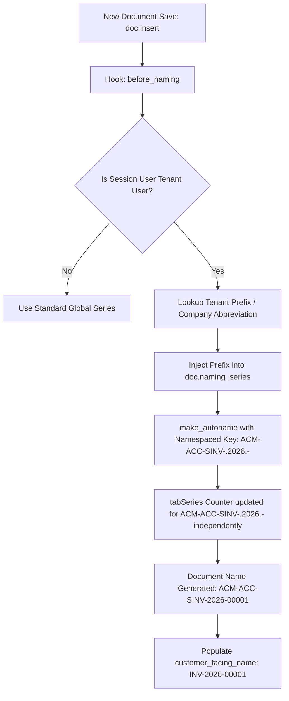

# Multi-Tenant Naming Series & Shared Singletons Architecture

> **Context:** Architectural specification for solving tenant-isolated Naming Series, Sequence Counters, and Global Singletons in `saas_platform`.

---

## 1. Executive Summary

In a shared-database, shared-schema multi-tenant Frappe architecture, row-level filtering (`tenant_id`) resolves data visibility, but **global state and shared singletons** introduce severe architectural failures:

1. **Naming Series & Counter Collisions (`tabSeries`):**
   - Counter sequences in `tabSeries` are shared globally across all tenants.
   - Number sequence gaps occur when multiple tenants share a prefix (violating tax and audit compliance like GST, VAT, and IFRS).
   - Document `name` is the SQL `PRIMARY KEY` on all DocType tables; two tenants cannot create a document with the same name.
2. **Single DocTypes (`tabSingles`):**
   - Settings DocTypes (`Global Defaults`, `Accounts Settings`, `Stock Settings`, `Selling Settings`, etc.) store key-value pairs in a single global table `tabSingles`.
   - Changes made by Tenant A overwrite the settings for Tenant B.
3. **Document Naming Settings & Rules:**
   - Prefix customization in the Frappe Desk modifies global DocField options or global `Document Naming Rule` records.
4. **Fiscal Years, Branding, and Workspaces:**
   - Multiple tenants operate in different tax jurisdictions with varying fiscal cycles, distinct letterheads, and customized workspaces.

---

## 2. Naming Series per Tenant: Deep Dive

### 2.1 The Root Problem

Frappe's naming engine ([frappe/model/naming.py](file:///Users/varkrish/personal/1frappe_ecosystem/frappe/frappe/model/naming.py)) generates document names via [make_autoname](file:///Users/varkrish/personal/1frappe_ecosystem/frappe/frappe/model/naming.py#L289-L313) calling [getseries](file:///Users/varkrish/personal/1frappe_ecosystem/frappe/frappe/model/naming.py#L428-L444):

```python
def getseries(key, digits):
    series = DocType("Series")
    current = (frappe.qb.from_(series).where(series.name == key).for_update().select("current")).run()

    if current and current[0][0] is not None:
        frappe.db.sql("UPDATE `tabSeries` SET `current` = `current` + 1 WHERE `name`=%s", (key,))
        current = cint(current) + 1
    else:
        frappe.db.sql("INSERT INTO `tabSeries` (`name`, `current`) VALUES (%s, 1)", (key,))
        current = 1
    return ("%0" + str(digits) + "d") % current
```

Default ERPNext series are hardcoded without company or tenant prefixes:
- `Sales Invoice`: `ACC-SINV-.YYYY.-`
- `Purchase Invoice`: `ACC-PINV-.YYYY.-`
- `Sales Order`: `SO-.YYYY.-`
- `Purchase Order`: `PO-.YYYY.-`
- `Journal Entry`: `ACC-JV-.YYYY.-`

#### The 3 Failure Modes:
1. **Primary Key Collision:**
   If Tenant A and Tenant B both configure `INV-.YYYY.-.#####` and start from 1, Tenant B's first invoice crashes with:
   `Duplicate entry 'INV-2026-00001' for key 'PRIMARY'` because `name` is the table's unique primary key.
2. **Audit & Tax Non-Compliance (The Number Gap Leak):**
   If both tenants share the default prefix `ACC-SINV-.2026.-`:
   - Tenant A issues: `ACC-SINV-2026-00001`
   - Tenant B issues: `ACC-SINV-2026-00002`
   - Tenant A issues: `ACC-SINV-2026-00003`
   Tenant A now has an unexplained gap (`00002` missing). In many jurisdictions (e.g. EU VAT, Indian GST, UK HMRC, Australian ATO), sequential invoice numbering with missing numbers triggers tax audits and fines for suspected off-the-books sales.
3. **Business Volume Information Leak:**
   Tenant A can monitor gaps in their sequential numbering to determine the total transaction volume of all other tenants on the SaaS cluster.

---

### 2.2 Solution Architecture: Namespaced Tenant Series

To guarantee **zero collisions**, **unbroken sequential numbering per tenant**, and **global primary key uniqueness**, naming series must be automatically namespaced using the tenant's identifier or company abbreviation.



#### Step 1: Automated Series Namespacing in `before_naming` Hook
Every tenant in `saas_platform` has an auto-provisioned `Company` with a unique abbreviation (`abbr`, e.g., `ACM`, `BET`).

Hook `before_naming` in `hooks.py`:
```python
doc_events = {
    "*": {
        "before_insert": "saas_platform.utils.set_tenant_id",
        "before_naming": "saas_platform.utils.naming.namespace_tenant_naming_series",
    }
}
```

Implementation in `saas_platform/saas_platform/utils/naming.py`:
```python
import frappe

def namespace_tenant_naming_series(doc, method=None):
    """
    Ensure every naming series is namespaced by the tenant's company abbreviation or tenant_id.
    Guarantees independent counters in tabSeries and eliminates PK collisions.
    """
    if frappe.session.user == "Administrator" or frappe.flags.in_migrate:
        return

    tenant_id = frappe.session.get("tenant_id")
    if not tenant_id or tenant_id == "SYSTEM":
        return

    # Determine tenant prefix (prefer Company abbreviation, fallback to tenant slug)
    tenant_prefix = None
    if getattr(doc, "company", None):
        tenant_prefix = frappe.get_cached_value("Company", doc.company, "abbr")

    if not tenant_prefix:
        tenant_prefix = frappe.db.get_value("Company", {"tenant_id": tenant_id}, "abbr")

    if not tenant_prefix:
        tenant_prefix = tenant_id[:6].upper()

    # If the DocType uses naming_series
    if hasattr(doc, "naming_series") and doc.naming_series:
        prefix_tag = f"{tenant_prefix}-"
        if not doc.naming_series.startswith(prefix_tag):
            # Prepend tenant prefix to series: e.g. ACC-SINV-.YYYY.- -> ACM-ACC-SINV-.YYYY.-
            doc.naming_series = f"{prefix_tag}{doc.naming_series}"
```

#### Step 2: Customer-Facing Invoices (Display Name)
While the internal database `name` is `ACM-ACC-SINV-2026-00001` (guaranteeing global uniqueness), external customer documents (PDFs, print formats) can display clean, unprefixed numbering.

1. Add a Custom Field `display_number` to transactional DocTypes (`Sales Invoice`, `Purchase Invoice`, `Quotation`, `Sales Order`).
2. Populate `display_number` in `autoname` or `after_insert`:
   ```python
   def set_display_number(doc, method=None):
       if doc.name and "-" in doc.name:
           # Strip the internal tenant prefix for customer display: INV-2026-00001
           prefix, rest = doc.name.split("-", 1)
           doc.display_number = rest
   ```
3. Update standard print formats to use `{{ doc.display_number or doc.name }}`.

---

## 3. The "Etc." Problem: Shared Singletons in Frappe

Beyond naming series, Frappe was built on single-tenant assumptions where numerous system components exist as singletons.

### 3.1 Single DocTypes (`tabSingles`)

#### The Problem:
Single DocTypes (`Accounts Settings`, `Stock Settings`, `Buying Settings`, `Selling Settings`, `Global Defaults`, `System Settings`) are stored in `tabSingles`:
```sql
CREATE TABLE `tabSingles` (
    `doctype` varchar(140) NOT NULL,
    `field` varchar(140) NOT NULL,
    `value` text,
    PRIMARY KEY (`doctype`,`field`)
);
```
There is **only one row per setting** for the entire database. If Tenant A modifies `default_currency` or `credit_limit_check`, it mutates configuration globally for all tenants.

#### The Solutions:

| Approach | Implementation | Pros | Cons |
| :--- | :--- | :--- | :--- |
| **Approach 1: Company-Level Settings (Recommended for ERPNext)** | In ERPNext, migrate tenant-specific operational settings to `Company` DocType custom fields (e.g. `Company.default_currency`, `Company.stock_valuation_method`). | 100% native; no core table schema hacks; fully supported by ERPNext multi-company features. | Limited to settings that can be logically attached to a Company. |
| **Approach 2: Multi-Tenant `tabSingles` Partitioning** | Alter `tabSingles` to add `tenant_id`: `PRIMARY KEY (doctype, field, tenant_id)` and monkey-patch `frappe.db.get_single_value` and `frappe.db.set_single_value`. | Full isolation across all Single DocTypes transparently. | Requires monkey-patching core database accessors; must handle cache keys per tenant in Redis. |

#### Implementation of Approach 2 (Tenant-Aware `tabSingles`):

1. **Alter `tabSingles` Schema Patch:**
   ```python
   frappe.db.sql("""
       ALTER TABLE `tabSingles`
       DROP PRIMARY KEY,
       ADD COLUMN `tenant_id` VARCHAR(140) DEFAULT 'SYSTEM',
       ADD PRIMARY KEY (`doctype`, `field`, `tenant_id`);
   """)
   ```

2. **Patch Single Accessors (`saas_platform/utils/singles.py`):**
   ```python
   import frappe
   from frappe.database.database import Database

   _orig_get_single_value = Database.get_single_value

   def tenant_aware_get_single_value(self, doctype, fieldname, cache=True):
       tenant_id = frappe.session.get("tenant_id")
       if not tenant_id or tenant_id == "SYSTEM" or frappe.session.user == "Administrator":
           return _orig_get_single_value(self, doctype, fieldname, cache=cache)

       # Check tenant-specific value first
       val = frappe.db.sql("""
           SELECT `value` FROM `tabSingles`
           WHERE `doctype`=%s AND `field`=%s AND `tenant_id`=%s
       """, (doctype, fieldname, tenant_id))

       if val and val[0][0] is not None:
           return val[0][0]

       # Fallback to system default
       return _orig_get_single_value(self, doctype, fieldname, cache=cache)

   Database.get_single_value = tenant_aware_get_single_value
   ```

---

### 3.2 Fiscal Years (`tabFiscal Year`)

Different tenants operate in different tax jurisdictions:
- **United States:** Jan 1 – Dec 31
- **India / UK:** Apr 1 – Mar 31
- **Australia:** Jul 1 – Jun 30

**Action:**
1. Ensure `Fiscal Year` has a `tenant_id` column.
2. In [Tenant.after_insert](file:///Users/varkrish/personal/1frappe_ecosystem/saas_platform/saas_platform/saas_platform/doctype/tenant/tenant.py#L49-L68), automatically provision the correct `Fiscal Year` linked to the tenant's `Company` based on their country.
3. Remove `Fiscal Year` from any exempt system doctype lists so `permission_query_conditions` filters it by tenant.

---

### 3.3 Branding, Letter Heads & Print Formats

- **Letter Head (`tabLetter Head`):** Must be tagged with `tenant_id`. Tenant A must never view or select Tenant B's corporate letterhead, logo, or tax registration header.
- **Print Format (`tabPrint Format`):** Custom print formats designed by Tenant A must have `tenant_id` set and isolated.
- **Address & Contact:** Already tagged with `tenant_id` via [add_tenant_id_to_all_tables.py](file:///Users/varkrish/personal/1frappe_ecosystem/saas_platform/saas_platform/patches/add_tenant_id_to_all_tables.py) and linked to the tenant's Company or Customer.

---

### 3.4 Outgoing Email Accounts & Background Jobs

- Standard Frappe uses a single default outgoing `Email Account`.
- Each tenant should either:
  1. Configure their own `Email Account` (SMTP / SendGrid / Amazon SES credentials) tagged with their `tenant_id`.
  2. Or use the platform's multi-tenant email router where the `from_email` and reply headers are dynamically set to the tenant's verified domain.

---

## 4. Architectural Summary

| Dimension | Challenge | SaaS Platform Solution |
| :--- | :--- | :--- |
| **Naming Series Counters** | Shared `tabSeries` counter leaks volume & causes gaps. | Auto-namespace series prefix with Company Abbreviation (`ACM-ACC-SINV-.YYYY.-`). |
| **Primary Key Collisions** | SQL `name` primary key collisions between tenants. | Globally unique prefixed names; optional clean `display_number` for customer PDFs. |
| **Single DocTypes (`tabSingles`)** | One global setting record per field across all tenants. | Company-level field overrides + Tenant-partitioned `tabSingles` (`tenant_id` composite key). |
| **Fiscal Periods** | Conflicting regional fiscal years. | Tenant-isolated `Fiscal Year` records linked to tenant Company. |
| **Reports** | Raw SQL bypasses ORM permissions. | AST-based SQL query rewriter ([report_tenant_isolation.md](file:///Users/varkrish/personal/1frappe_ecosystem/saas_platform/docs/report_tenant_isolation.md)). |
| **Brand Assets** | Letterheads, templates, print formats shared. | Row-level tenant isolation applied to `Letter Head` and `Print Format`. |
